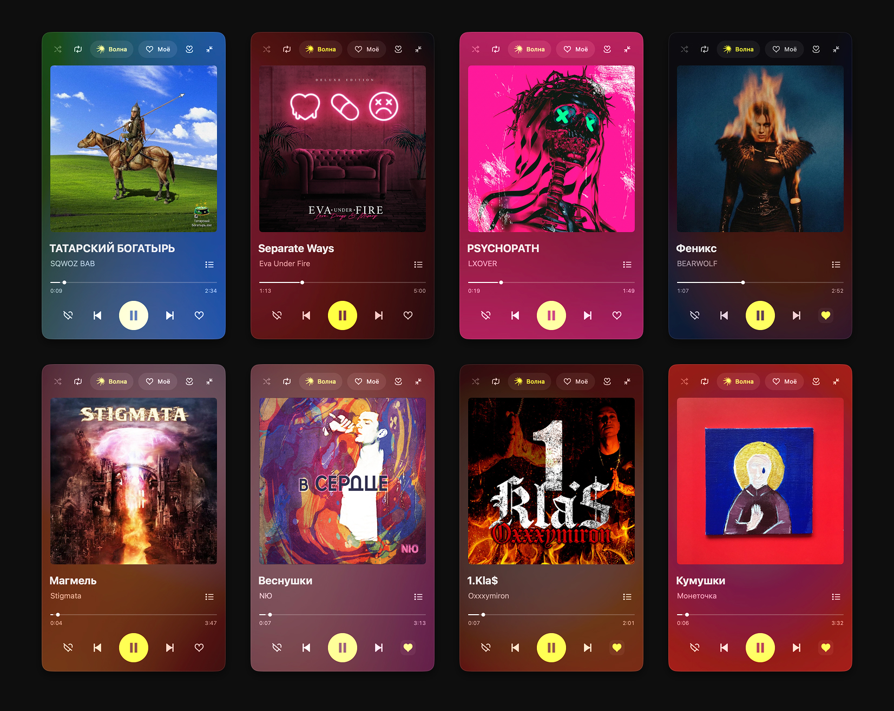
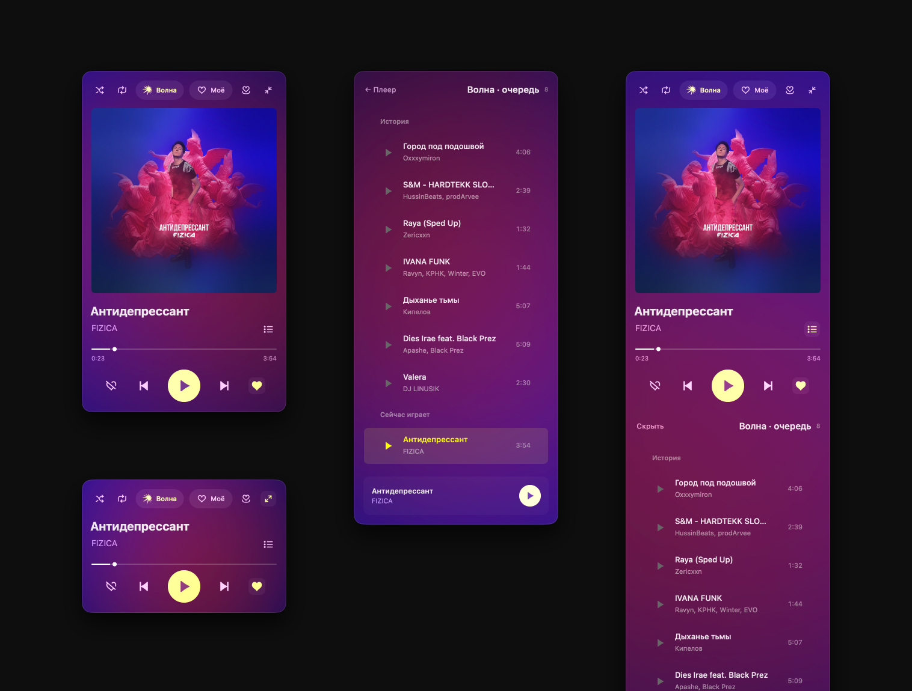

# Моя музыка

**Небольшой неофициальный плеер Яндекс Музыки для macOS.**

Цвета обложки, «Волна», любимые треки и очередь — в одном окне, которое можно сделать совсем маленьким.

[**Скачать для Mac ↓**](https://github.com/archetypetrickster-tech/moya-music/releases/latest/download/moya-music-macos.zip) · [Страница проекта](https://archetypetrickster-tech.github.io/moya-music/) · [Сообщить об ошибке](https://github.com/archetypetrickster-tech/moya-music/issues)



## Что умеет

- **Волна и Моё.** Единый переключатель с плавной подсветкой: персональные рекомендации и понравившиеся треки.
- **Обложка задаёт цвет.** Размытый фон медленно вращается и меняется вместе с музыкой.
- **Компактный режим.** Маленькая обложка рядом с названием и исполнителем, когда нужно больше места.
- **Очередь.** Вместо плеера или под ним при увеличении высоты окна. В «Волне» — история и один следующий трек, в «Моём» — текущая очередь сайта.
- **Обычное окно и полный экран.** Системное размещение у краёв, Split View, штатные кнопки в полноэкранном режиме.
- **Поверх окон.** Закрепление булавкой, выбор сохраняется.
- **Настройки под шестерёнкой.** Автозапуск, автовоспроизведение и HTTP CONNECT / SOCKS5 (macOS 14+). Музыка сама не включается по умолчанию, включая пробуждение.
- **Автозапуск по выбору.** При входе в систему и при подключении распознанных наушников. Подключение не включает музыку автоматически.
- **Лайк, дизлайк, повтор и перемешивание.** Перемешивание доступно в «Моём»; порядок «Волны» задаёт Яндекс.



## Установка без ИИ и команд

1. [Скачайте готовый архив](https://github.com/archetypetrickster-tech/moya-music/releases/latest/download/moya-music-macos.zip) и полностью распакуйте его.
2. Дважды нажмите **«Установить.command»**.
3. Выберите `1` — без автозапуска, `2` — запуск при входе или `3` — дополнительно запуск при подключении наушников.
4. Войдите в свой аккаунт на странице Яндекса и нажмите **«Волна»** или **«Моё»**.

Можно просто перетащить **«Моя музыка.app»** в **«Программы»**. Для изменения автозапуска есть отдельные файлы **«Настроить автозапуск.command»** и **«Отключить автозапуск.command»**.

Для установки готовой сборки не нужны ИИ, Xcode, Python или Node.js. При обновлении вход в Яндекс и история сохраняются вне приложения. После обновления при необходимости нажмите воспроизведение.

### Если macOS блокирует запуск

Приложение имеет локальную техническую подпись, но пока не заверено Apple для распространения. Если доверяете источнику, после попытки запуска зайдите в **«Системные настройки → Конфиденциальность и безопасность»** и подтвердите открытие конкретного файла кнопкой **«Всё равно открыть»**. Глобально отключать защиту Mac не требуется.

## Требования и ограничения

- Целевая минимальная система — **macOS 13**.
- Готовая сборка универсальная: **Apple Silicon + Intel**. Работа проверена на Apple Silicon. Запуск на Intel и старых версиях macOS отдельно не проверялся.
- Нужны интернет и доступ к Яндекс Музыке в вашем аккаунте. Офлайн-загрузка не реализована.
- Это оболочка сайта, поэтому изменения сайта могут потребовать обновления плеера.
- История «Волны» сохраняется локально, до 150 предыдущих треков. Старый трек, которого уже нет в очереди сайта, открывается через его страницу и может изменить контекст воспроизведения.

### Прокси и VPN

Прокси нужно настроить собственными адресом и портом: HTTP CONNECT или SOCKS5. Логин и пароль необязательны, пароль хранится в Связке ключей macOS. Выключение возвращает системное подключение. Изменение подключения перезагружает библиотеку и останавливает трек. Поддержка на macOS 14+ использует [штатный API WebKit](https://developer.apple.com/documentation/webkit/wkwebsitedatastore/proxyconfigurations-cdc1). Это не отключение VPN и не гарантия обхода любого туннеля: иногда нужно исключение в настройках самого VPN-клиента.

## Данные и вход

Пароль вводится на странице Яндекса. Приложение не требует передавать разработчику токены или данные аккаунта. Сессия хранится локально средствами WebKit. В публичном репозитории и архиве нет пользовательских cookies, истории прослушивания или входа в аккаунт.

## Собрать из исходников

Нужны Xcode или Command Line Tools **с SDK macOS 27+**. Это требование сборки, а не запуска готового приложения.

```sh
git clone https://github.com/archetypetrickster-tech/moya-music.git
cd moya-music
zsh Исходники/build.sh
```

Рядом с исходниками появится универсальная **«Моя музыка.app»**. Сборка использует системные AppKit, WebKit, CoreAudio и CoreImage; дополнительные зависимости скачивать не нужно. После сборки можно открыть корневой **«Установить.command»**.

Основные файлы:

| Файл | Назначение |
|---|---|
| `Исходники/main.swift` | Интерфейс, WebKit, эмбиент и управление |
| `Исходники/WindowBehavior.swift` | Окна, полный экран и расположение кнопок |
| `Исходники/ConnectionSettings.swift` | Настройки, прокси, Keychain и автозапуск |
| `Исходники/SourceSwitch.swift` | Переключатель источника, анимация и клавиатура |
| `Исходники/QueueView.swift` | Интерфейс очереди |
| `Исходники/bridge.js` | Воспроизведение и состояние трека |
| `Исходники/queue-engine.js` | Очередь сайта и история |
| `Исходники/headphones.swift` | Запуск при новом подключении наушников |
| `Исходники/install.sh` | Установка, обновление и автозапуск |

Исследовательские команды отключены при обычном запуске и доступны только с явным `--debug` или `--live-check`.

### Проверки для разработчиков

```sh
# После сборки: локальная проверка без аккаунта и музыки
./Моя\ музыка.app/Contents/MacOS/MoyaMusic --self-test

# Полный экран, выход, сворачивание и геометрия окна
# Временно переключает тестовое окно в полный экран и обратно
./Моя\ музыка.app/Contents/MacOS/MoyaMusic --window-test

# Дополнительно нужны Python 3 и Node.js только для этих проверок
python3 Исходники/tests/check-installer.py
node Исходники/tests/check-queue.js

# Проверка WebKit через локальные HTTP/SOCKS5 серверы, macOS 14+
python3 Исходники/tests/check-proxy.py
```

Установщик проверяется на временных копиях с подменой системных действий. Реальные программы и задания автозапуска не меняются.

## Автор и участие

**Максим Чистов**, арт-директор [«Девять квадратов»](https://ninesquares.ru/).

Идея, интерфейс и арт-дирекшн — Максим Чистов. Приложение собрано и доработано с помощью Codex. Проект начался с желания сделать удобный маленький плеер для своего Mac.

Ошибки и предложения — в [Issues](https://github.com/archetypetrickster-tech/moya-music/issues). Для ошибки полезны версия macOS, тип процессора и короткое описание действий. Не прикладывайте cookies, токены, пароли или персональные логи. Исправления можно предлагать через pull request.

## Лицензия и графика

Оригинальный код проекта — [MIT](LICENSE). Лицензия кода не распространяется на графику Яндекс Музыки, обложки альбомов и предоставленные демонстрационные изображения: см. [NOTICE](NOTICE.md). Это независимый неофициальный проект, не связанный с Яндексом.

---

*A small, independent Yandex Music player for macOS. Native AppKit interface, artwork colors, compact mode, playback queue and optional headphone launch. A ready-to-install Universal 2 build is available in Releases. This project is not affiliated with Yandex.*
